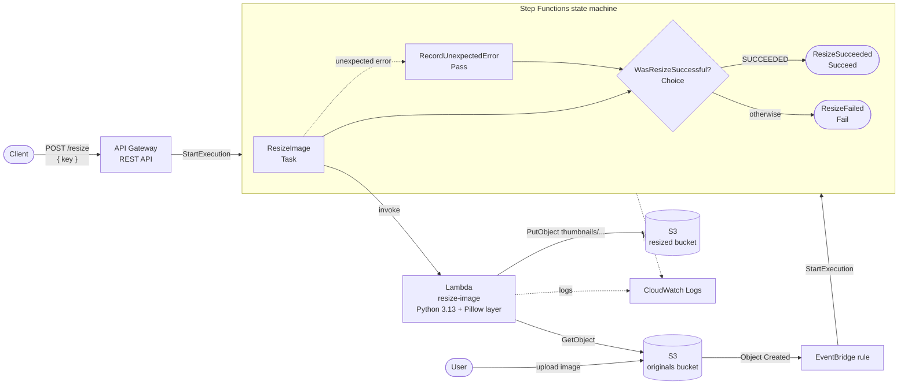
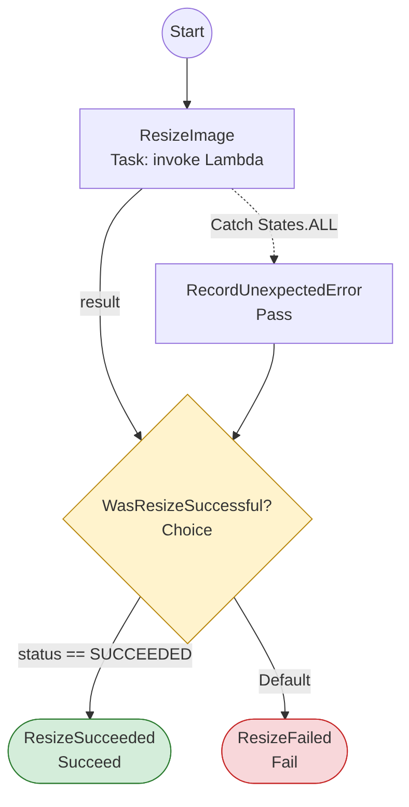
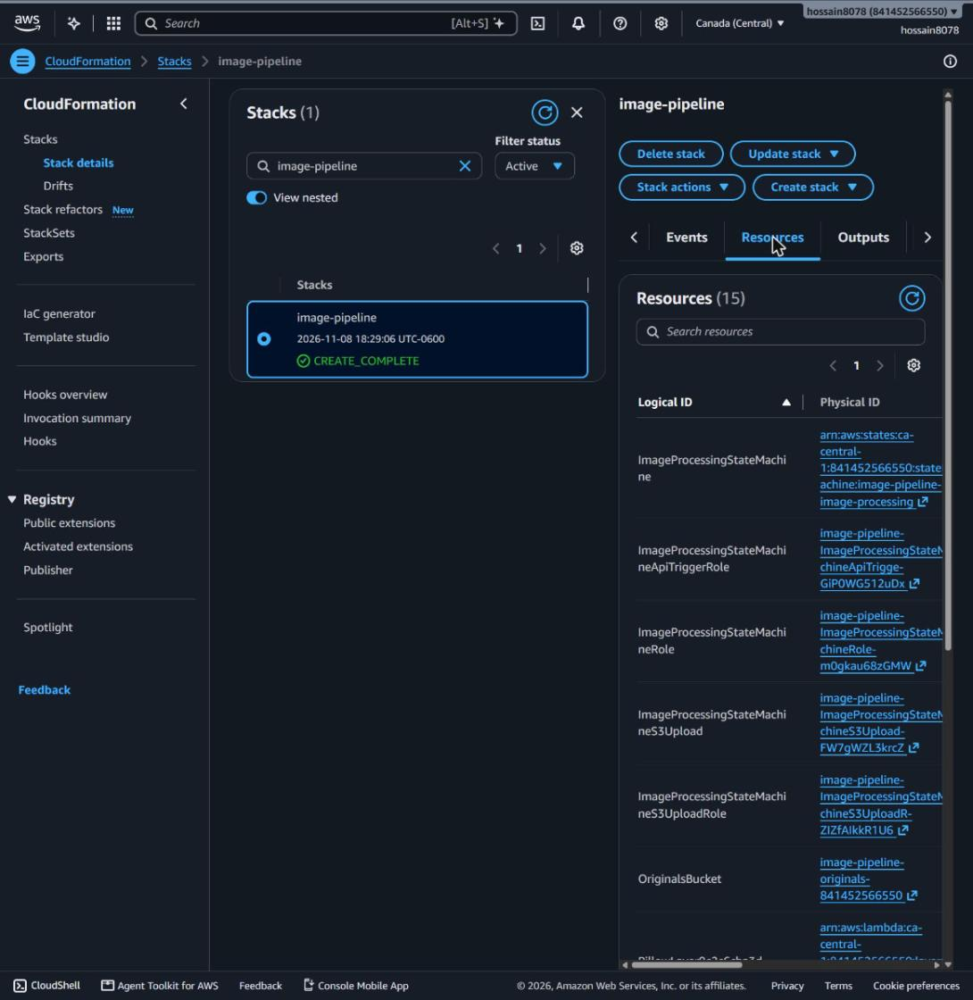
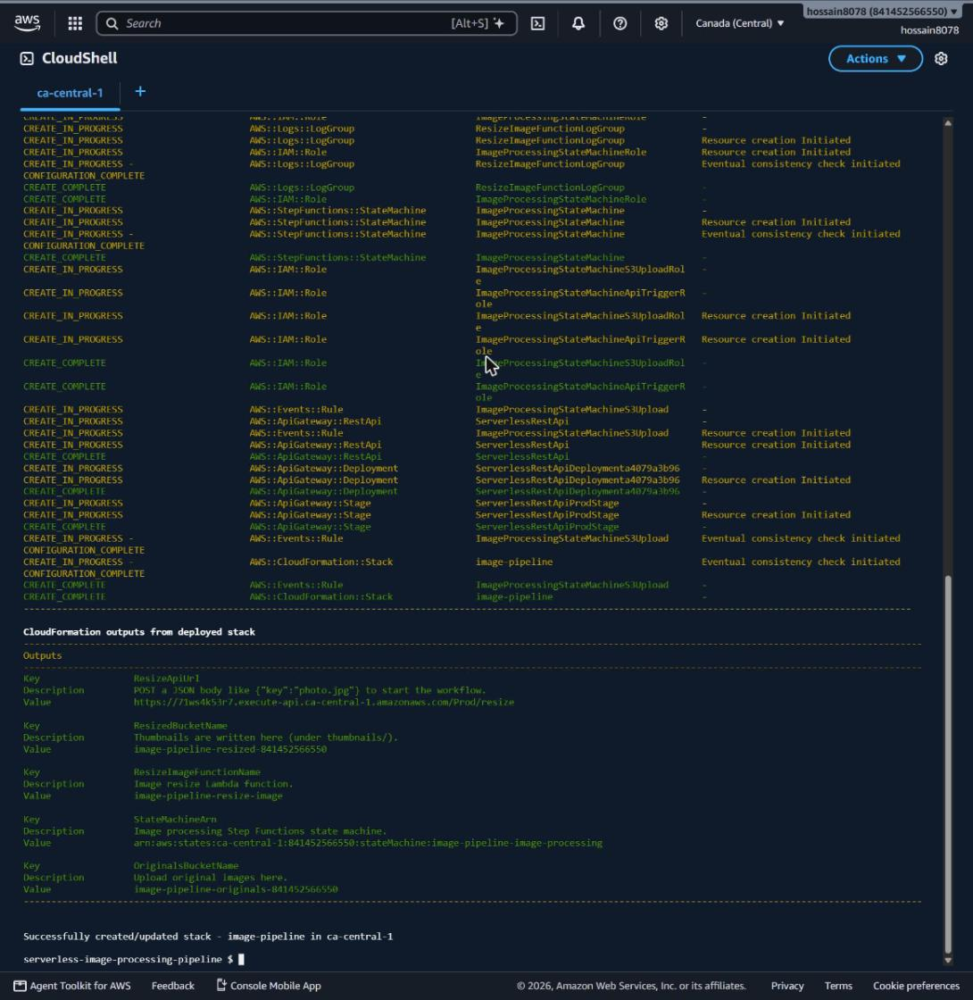
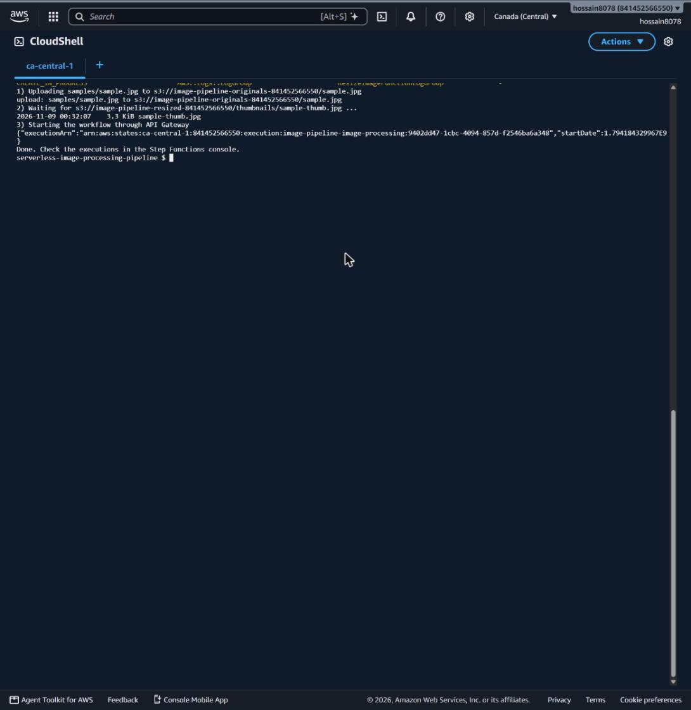
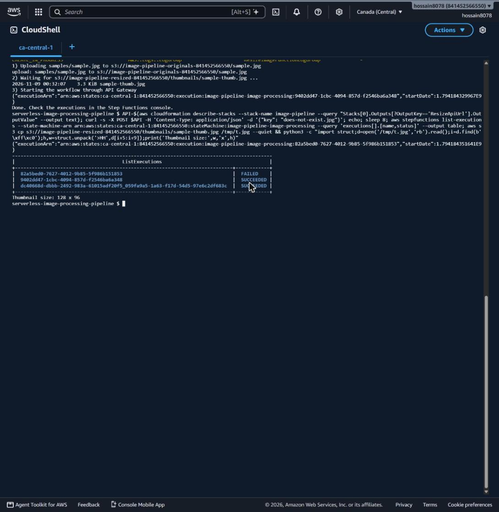
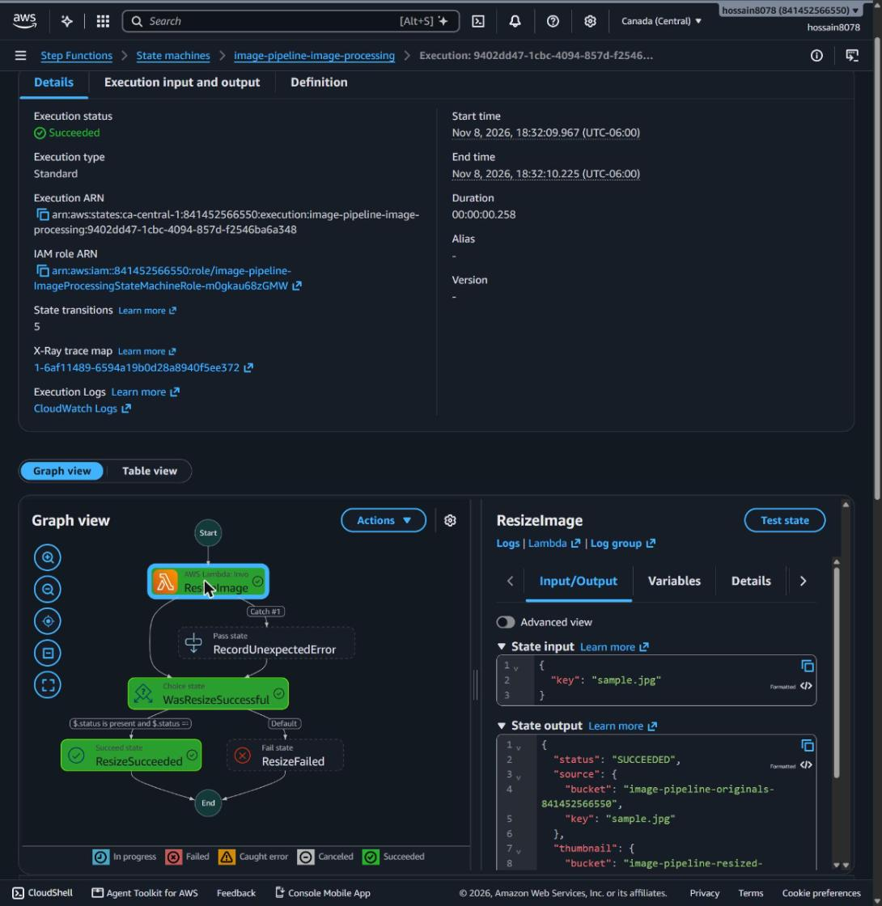
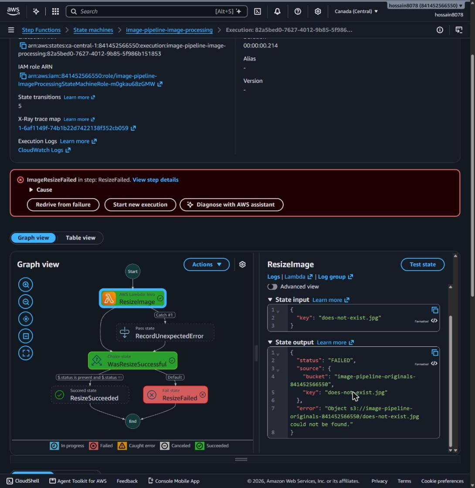
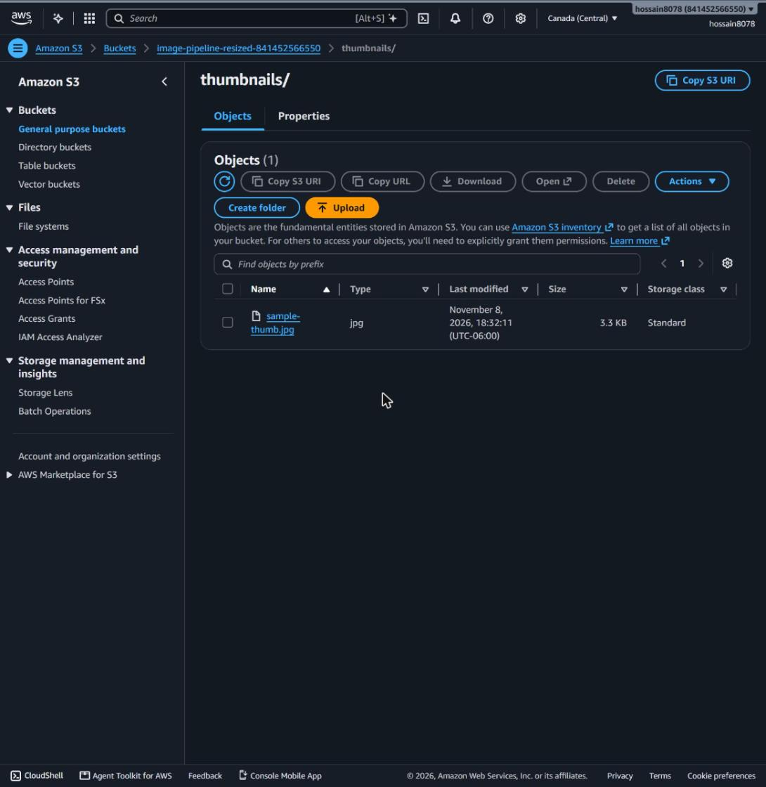

# Serverless Image Processing Pipeline

A serverless AWS application that automatically turns uploaded images into thumbnails.

When an image lands in the **originals** S3 bucket, or a client calls the **API Gateway** endpoint, an **AWS Step Functions** state machine invokes a **Lambda** function. The function resizes the image with **Pillow** and saves the thumbnail in a second **resized** S3 bucket. **CloudWatch** keeps the logs and execution history.

> **Capstone Project:** Cloud Computing, Saskatchewan Polytechnic (Business Information Systems)<br>
> **Author:** Md Alamgir Hossain

---

## Table of contents

1. [Architecture](#architecture)
2. [How it meets the requirements](#how-it-meets-the-requirements)
3. [Repository structure](#repository-structure)
4. [Prerequisites](#prerequisites)
5. [Deploy](#deploy)
6. [Test the application](#test-the-application)
7. [Deployment results](#deployment-results)
8. [Run the unit tests](#run-the-unit-tests)
9. [Configuration](#configuration)
10. [Monitoring and troubleshooting](#monitoring-and-troubleshooting)
11. [Clean up](#clean-up)
12. [Design decisions](#design-decisions)

---

## Architecture



Plain-text version (from the assignment brief):

```
+-------------+   +----------------+   +-----------------+   +------+
| API Gateway |-->| Step Functions |-->| Lambda Function |-->|  S3  |
+-------------+   +----------------+   +-----------------+   +------+
                          ^
                          |
                  +----------------+
                  |   CloudWatch   |
                  +----------------+
```

### State machine



| State | Type | Purpose |
|---|---|---|
| `ResizeImage` | Task | Calls the resize Lambda and retries transient Lambda service errors |
| `RecordUnexpectedError` | Pass | Turns a crash or timeout into a `{"status": "FAILED"}` result |
| `WasResizeSuccessful` | Choice | Checks whether `$.status == "SUCCEEDED"` |
| `ResizeSucceeded` | Succeed | The thumbnail was created |
| `ResizeFailed` | Fail | The image could not be resized |

---

## How it meets the requirements

| Assignment requirement | Implementation |
|---|---|
| S3 bucket for original images | `OriginalsBucket`: `<stack>-originals-<account-id>` |
| Lambda runs when a new image is uploaded | S3 → EventBridge → Step Functions → `ResizeImageFunction` |
| Lambda resizes the image to a thumbnail | Pillow `Image.thumbnail()`, longest side 128 px by default, aspect ratio kept |
| Resized image stored in another bucket | `ResizedBucket`: `<stack>-resized-<account-id>/thumbnails/` |
| Step Functions orchestrates the workflow | `ImageProcessingStateMachine` with Task, Choice, Succeed and Fail states |
| API Gateway endpoint triggers the state machine | `POST /resize` on a REST API, connected directly to `states:StartExecution` |
| Pillow added to Lambda | `PillowLayer`, a Lambda Layer built by SAM from `layers/pillow/requirements.txt` |

---

## Repository structure

```
.
├── template.yaml                     # AWS SAM template (all infrastructure as code)
├── samconfig.toml                    # Default sam deploy settings
├── statemachine/
│   └── image_processing.asl.json     # Step Functions definition (Amazon States Language)
├── src/resize_image/
│   ├── app.py                        # Lambda handler (Pillow thumbnail logic)
│   └── requirements.txt
├── layers/pillow/
│   └── requirements.txt              # Pillow, packaged as a Lambda Layer
├── tests/                            # pytest unit tests (no AWS account needed)
├── events/                           # Sample inputs for local / console testing
├── scripts/
│   ├── test_pipeline.ps1             # End-to-end test (Windows PowerShell)
│   └── test_pipeline.sh              # End-to-end test (macOS / Linux)
├── samples/sample.jpg                # Test image (1600x1200)
└── docs/                             # Screenshots for the README
```

---

## Prerequisites

- An **AWS account** with permission to create S3, Lambda, Step Functions, API Gateway, EventBridge, IAM and CloudWatch resources
- **AWS CLI v2**, configured with `aws configure`
- **AWS SAM CLI** ([install guide](https://docs.aws.amazon.com/serverless-application-model/latest/developerguide/install-sam-cli.html))
- **Python 3.13**
- *(Optional)* **Docker**, only if you want to build with `--use-container`
- **Git**

> **Tip:** Nothing to install? Open **AWS CloudShell** in the AWS Console. It already includes the AWS CLI, SAM CLI, Python 3.13 and Git, and it uses your console credentials. This project was deployed that way.

Check your setup:

```bash
aws --version
sam --version
python --version
aws sts get-caller-identity
```

---

## Deploy

### 1. Clone the repository

```bash
git clone https://github.com/hossain8078/serverless-image-processing-pipeline.git
cd serverless-image-processing-pipeline
```

### 2. Build

```bash
sam build
```

SAM packages the Lambda code and builds the Pillow layer. It downloads the Linux (manylinux) wheel that Lambda needs, so this works on Windows, macOS and Linux. If the build fails on your machine, run `sam build --use-container` (requires Docker).

### 3. Deploy

```bash
sam deploy --guided
```

Suggested answers:

| Prompt | Value |
|---|---|
| Stack Name | `image-pipeline`. **Use lowercase letters only**, because it becomes part of the bucket names |
| AWS Region | e.g. `ca-central-1` or `us-east-1` |
| Parameter ThumbnailSize | `128` |
| Confirm changes before deploy | `y` |
| Allow SAM CLI IAM role creation | `y` |
| ImageProcessingStateMachine ApiTrigger has no authentication. Is this okay? | `y` |
| Save arguments to configuration file | `y` |

After the first deployment, `sam deploy` on its own is enough.

### 4. Note the outputs

When the deployment finishes, SAM prints these outputs:

| Output | Example |
|---|---|
| `OriginalsBucketName` | `image-pipeline-originals-123456789012` |
| `ResizedBucketName` | `image-pipeline-resized-123456789012` |
| `StateMachineArn` | `arn:aws:states:ca-central-1:123456789012:stateMachine:image-pipeline-image-processing` |
| `ResizeApiUrl` | `https://abc123.execute-api.ca-central-1.amazonaws.com/Prod/resize` |

You can show them again at any time:

```bash
aws cloudformation describe-stacks --stack-name image-pipeline --query "Stacks[0].Outputs" --output table
```

---

## Test the application

### Option A: Upload an image (automatic trigger)

```bash
aws s3 cp samples/sample.jpg s3://<OriginalsBucketName>/sample.jpg
```

Wait a few seconds, then check the resized bucket:

```bash
aws s3 ls s3://<ResizedBucketName>/thumbnails/
# 2026-11-08 10:15:02   3.1 KiB sample-thumb.jpg
```

Download the thumbnail to compare it with the original:

```bash
aws s3 cp s3://<ResizedBucketName>/thumbnails/sample-thumb.jpg .
```

### Option B: Call the API Gateway endpoint

The image must already be in the originals bucket.

**PowerShell**

```powershell
Invoke-RestMethod -Method Post -Uri "<ResizeApiUrl>" -ContentType "application/json" -Body '{"key": "sample.jpg"}'
```

**curl**

```bash
curl -X POST "<ResizeApiUrl>" -H "Content-Type: application/json" -d '{"key": "sample.jpg"}'
```

Response:

```json
{"executionArn": "arn:aws:states:...:execution:image-pipeline-image-processing:...", "startDate": 1.78E9}
```

### Option C: Run the scripted end-to-end test

```powershell
.\scripts\test_pipeline.ps1 -StackName image-pipeline
```

```bash
./scripts/test_pipeline.sh image-pipeline
```

### See the failure path

Send a key that doesn't exist. The execution ends in the `ResizeFailed` state:

```bash
curl -X POST "<ResizeApiUrl>" -H "Content-Type: application/json" -d '{"key": "does-not-exist.jpg"}'
```

Open **Step Functions → State machines → image-pipeline-image-processing** in the AWS Console to see both executions. The graph view shows which path each one took.

### Supported input formats

The Lambda accepts any of these inputs, so it can be tested from the Step Functions console with **Start execution**:

```json
{ "key": "sample.jpg" }
{ "bucket": "<OriginalsBucketName>", "key": "sample.jpg" }
```

EventBridge `Object Created` events and classic S3 notifications are handled automatically. For safety, the function only reads from the originals bucket.

---

## Deployment results

The stack was deployed from **AWS CloudShell** to `ca-central-1` with `sam build` and `sam deploy`, then tested end to end.

| Test | Trigger | Result |
|---|---|---|
| Upload `samples/sample.jpg` (1600×1200, 123 KB) | S3 → EventBridge | ✅ Succeeded: `thumbnails/sample-thumb.jpg` (128×96, 3.3 KB) |
| `POST /resize {"key": "sample.jpg"}` | API Gateway | ✅ Succeeded |
| `POST /resize {"key": "does-not-exist.jpg"}` | API Gateway | ❌ Failed as expected, through the Choice state to `ResizeFailed` |

**Stack deployed (15 resources)**



**`sam deploy` outputs**



**End-to-end test: upload, thumbnail created, API call**



**Executions (two succeeded, one failed) and thumbnail size check**



**Successful execution: Task → Choice → Succeed**



**Failed execution: Task → Choice → Fail**



**Thumbnail in the resized bucket**



---

## Run the unit tests

The tests stub S3, so they need no AWS account.

```bash
python -m venv .venv
# Windows: .venv\Scripts\activate    macOS/Linux: source .venv/bin/activate
pip install -r requirements-dev.txt
python -m pytest -v
```

The tests cover event parsing (API, EventBridge and S3 events), thumbnail sizing and aspect ratio, PNG transparency, and every failure case (missing file, corrupt image, unsupported type, wrong bucket, missing key). They also check that the state machine definition is valid.

---

## Configuration

| Setting | Where | Default |
|---|---|---|
| Thumbnail size (longest side, px) | `ThumbnailSize` parameter | `128` |
| Thumbnail key prefix | `THUMBNAIL_PREFIX` env var | `thumbnails/` |
| Maximum image size | `MAX_IMAGE_BYTES` env var | 20 MB |
| Supported formats | `SUPPORTED_FORMATS` in `app.py` | JPG, JPEG, PNG, GIF, WEBP |

To change the thumbnail size:

```bash
sam deploy --parameter-overrides ThumbnailSize=256
```

---

## Monitoring and troubleshooting

| Where | What you'll find |
|---|---|
| CloudWatch log group `/aws/lambda/image-pipeline-resize-image` | Each resize, with input, output key, size and any error |
| CloudWatch log group `/aws/vendedlogs/states/image-pipeline-image-processing` | Every state transition, with input and output data |
| Step Functions console | Visual execution history and the path each run took |
| AWS X-Ray | Traces across Step Functions and Lambda (tracing is enabled) |

Tail the Lambda logs live:

```bash
sam logs --stack-name image-pipeline --name ResizeImageFunction --tail
```

| Problem | Fix |
|---|---|
| `Bucket name ... is not valid` on deploy | Use a lowercase stack name |
| `No module named 'PIL'` in the Lambda logs | Rebuild with `sam build --use-container`, then `sam deploy` |
| No thumbnail after upload | Check that the file extension is supported, then look at the latest Step Functions execution |
| API returns `{"executionArn": ...}` but no thumbnail | The API starts the workflow asynchronously. Check that execution in the console |

---

## Clean up

S3 buckets must be empty before CloudFormation can delete them:

```bash
aws s3 rm s3://<OriginalsBucketName> --recursive
aws s3 rm s3://<ResizedBucketName> --recursive
sam delete --stack-name image-pipeline
```

---

## Design decisions

- **Infrastructure as code (AWS SAM).** Every resource is defined in `template.yaml`, so the stack can be rebuilt the same way every time.
- **S3 → EventBridge → Step Functions.** Uploads go through the state machine instead of calling Lambda directly, so automatic and API-triggered runs share one workflow with the same success and failure handling. The trigger only listens to the originals bucket, so writing thumbnails cannot start another run.
- **Two layers of error handling.** Expected problems (bad input, missing or corrupt file) come back as `status: FAILED`, and the Choice state sends them to `ResizeFailed`. Unexpected errors (timeouts, crashes) are caught by the Task's `Catch` and routed through the same Choice state. Transient Lambda service errors are retried with exponential backoff.
- **Least-privilege IAM.** The Lambda can only *read* the originals bucket and *write* to the resized bucket. The state machine can only invoke this one function.
- **Secure by default.** Both buckets block all public access and use server-side encryption. The Lambda ignores requests for any bucket other than the originals bucket.
- **Pillow as a Lambda Layer.** The dependency is kept separate from the function code, as the AWS documentation recommends.
- **Image quality details.** EXIF orientation is applied, so phone photos aren't rotated. The aspect ratio is kept. Transparent PNGs stay transparent, and JPEGs are converted to RGB when needed.

### Known limitations and possible improvements

- The API has no authentication. For production, add an API key, IAM auth or a Cognito authorizer.
- The API returns the execution ARN straight away. A synchronous Express workflow could return the thumbnail location in the response instead.
- Thumbnails are a single size. A `Map` state could create several sizes in parallel.

---

## License

[MIT](LICENSE)
